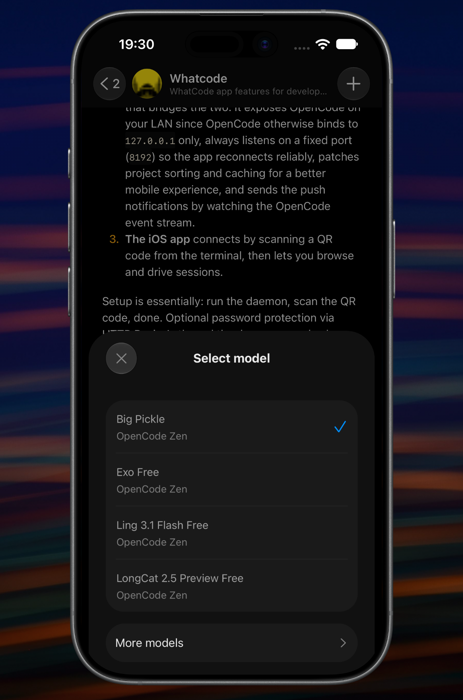
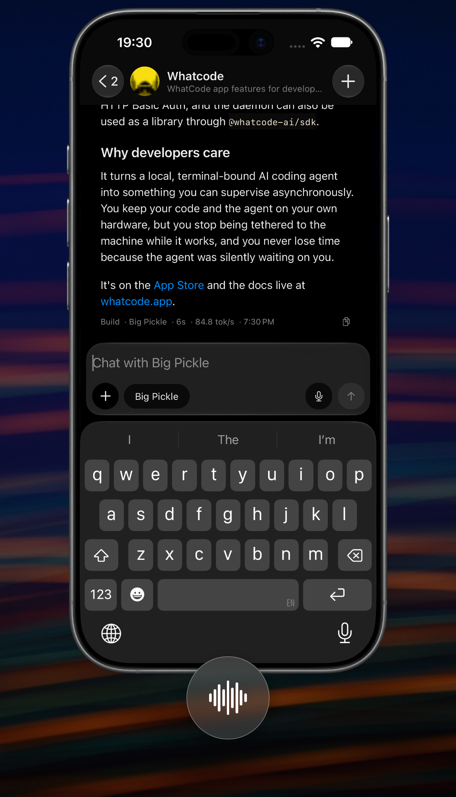
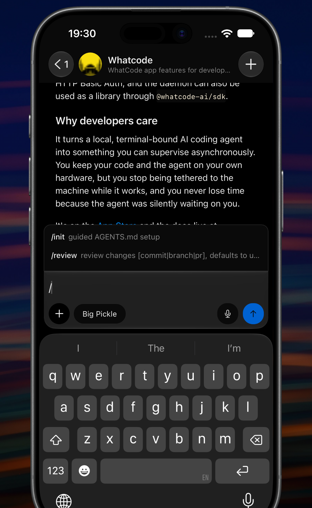

# whatcode-ai

[](https://www.npmjs.com/package/@whatcode-ai/whatcode)
[](https://www.npmjs.com/package/@whatcode-ai/sdk)
[](https://www.npmjs.com/package/@whatcode-ai/whatcode)
[](https://www.npmjs.com/package/@whatcode-ai/sdk)
[](./LICENSE)

Monorepo that provides a one-script setup to start [opencode](https://opencode.ai) and optionally expose it over HTTPS via [Tailscale](https://tailscale.com), so you can connect to it from anywhere (e.g. a private iOS app).

<p align="center">
  
  
  
  
</p>

## Documentation

Full docs, API reference, and guides live at **[whatcode.app](https://whatcode.app)**.

## Quick start

```bash
npx @whatcode-ai/whatcode start
# or with Tailscale
npx @whatcode-ai/whatcode start --tailscale
```

## Packages

| Package                                        | Description                   |
| ---------------------------------------------- | ----------------------------- |
| [`@whatcode-ai/whatcode`](./packages/whatcode) | `whatcode` CLI                |
| [`@whatcode-ai/sdk`](./packages/sdk)           | Core SDK (programmatic usage) |
| [`@whatcode-ai/example`](./apps/example)       | Minimal usage example         |

## Development

```bash
git clone https://github.com/Pnlvfx/whatcode-ai.git
cd whatcode-ai
pnpm install
pnpm build
```

## License

MIT
